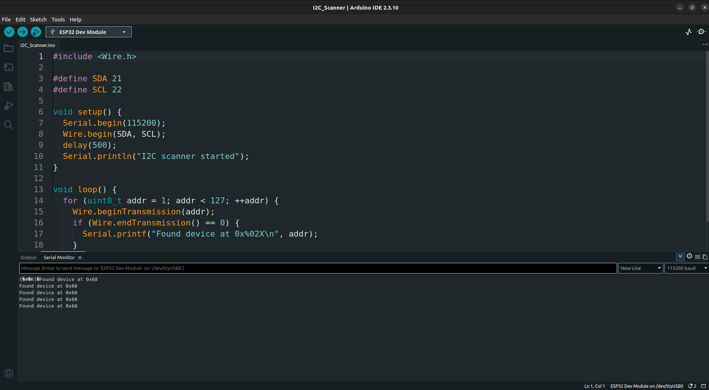
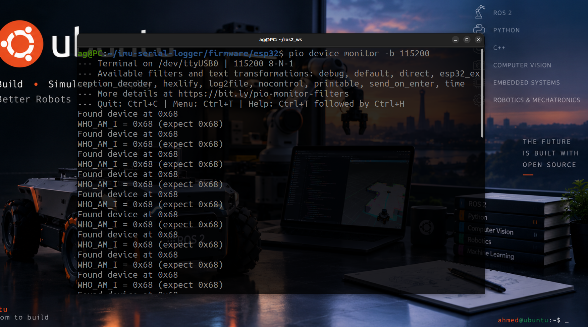
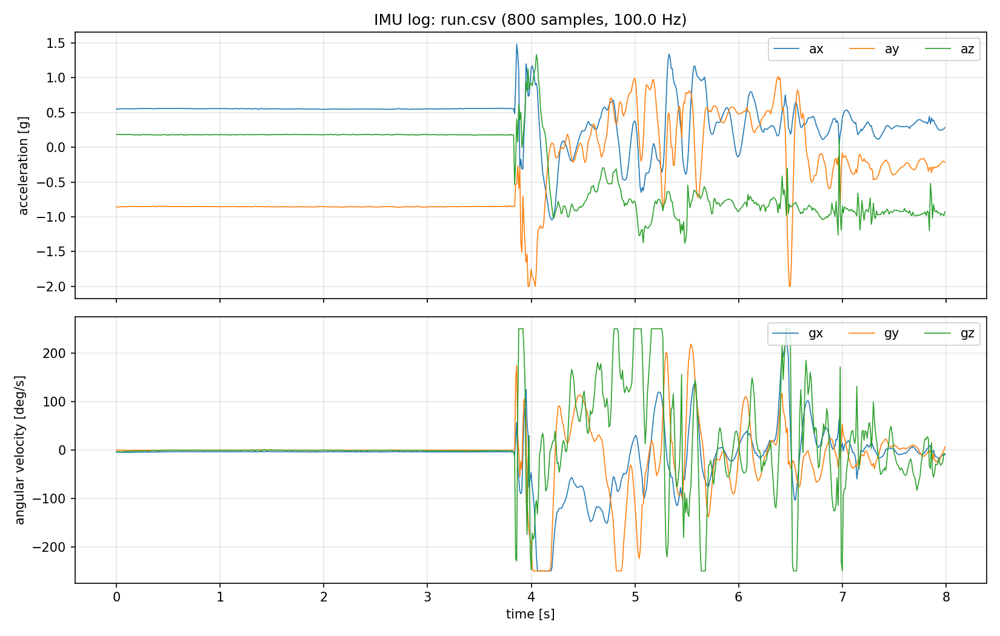
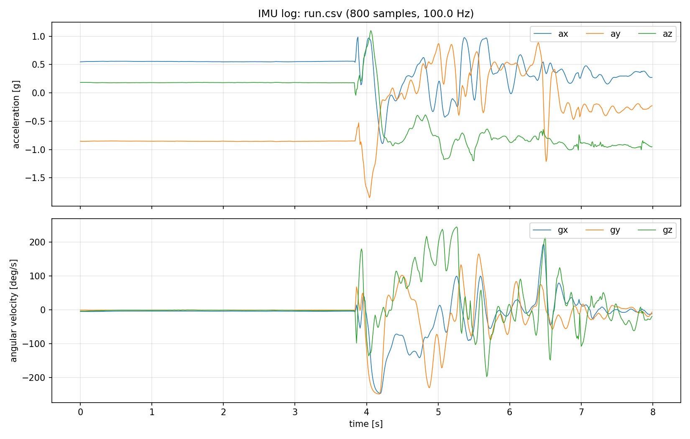
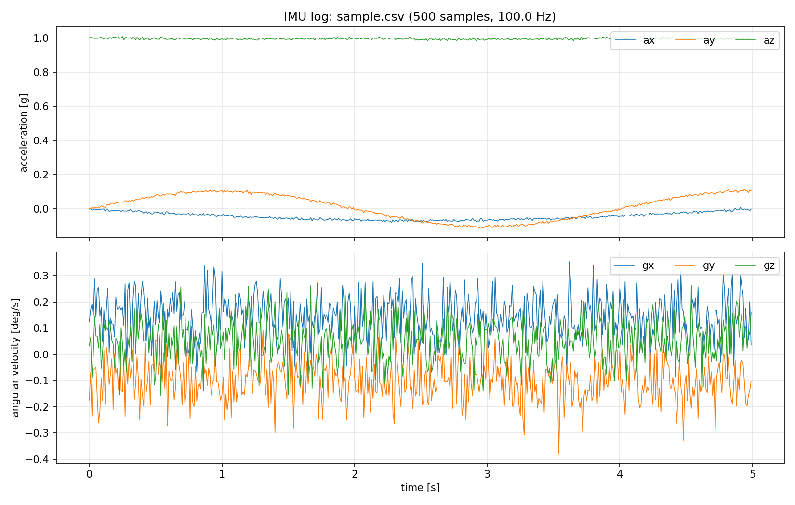

# IMU Serial Logger

Reads raw acceleration and angular velocity from an MPU6050 over I2C, streams
CSV from an ESP32 over USB serial, logs it with a C++ program, and analyses it
in Python.

**Status:** v1.0.0 complete. The end-to-end pipeline is implemented and
verified on hardware. Firmware, logger, and analysis are built as part of
Phase 1 of the Robotics Software Engineer roadmap.

## Hardware

| Part | Notes |
|---|---|
| ESP32 DevKit | Main controller |
| MPU6050 / GY-521 | 3.3 V, I2C |
| USB data cable | Must support data, not charge-only |
| Jumper wires | 4 wires |

Arduino Uno/Nano/Mega can be used as a fallback, but the ESP32 is the target.

## Wiring

| MPU6050 (GY-521) | ESP32 DevKit |
|---|---|
| VCC | 3V3 |
| GND | GND |
| SDA | GPIO 21 (D21) |
| SCL | GPIO 22 (D22) |
| AD0 | GND (address `0x68`) |
| INT | not connected |

The MPU6050 is a 3.3 V device. Do not power it from 5 V while it is connected
to the ESP32.

Scanner output during bring-up. Both the Arduino sketch and the PlatformIO
build found the sensor at `0x68` and read `WHO_AM_I = 0x68`:

| Arduino IDE | PlatformIO monitor |
|---|---|
|  |  |

The PlatformIO project now runs the 100 Hz CSV streamer rather than the
scanner.

## Architecture

```
MPU6050 --I2C--> ESP32 --USB serial--> C++ logger --> CSV --> Python analysis
```

Each stage is tested independently:

- firmware: I2C scanner, `WHO_AM_I` check, and CSV streamer builds in CI,
- logger: parser unit tests and a serial end-to-end check,
- analysis: CSV loading, filter, and calibration unit tests.

## Repository layout

```
imu-serial-logger/
├── firmware/
│   ├── i2c_scanner/    # Arduino bring-up sketch
│   └── esp32/          # PlatformIO CSV streamer
├── logger/             # C++17 host logger (CMake)
├── analysis/           # Python package, plots, calibration, filters
├── data/               # logs (CSV files ignored except sample.csv)
├── docs/               # wiring, protocol, design
└── media/              # plots and demo assets
```

`firmware/i2c_scanner` is the Arduino bring-up sketch. `firmware/esp32`
contains the PlatformIO streamer, which emits the CSV format described in
[docs/protocol.md](docs/protocol.md).

## Build and run

### Firmware

```bash
cd firmware/esp32
pio run -t upload
pio device monitor -b 115200
```

### Logger

```bash
cmake -S logger -B logger/build -DCMAKE_BUILD_TYPE=Debug
cmake --build logger/build -j
ctest --test-dir logger/build --output-on-failure

./logger/build/imu_logger --port /dev/ttyUSB0 --out data/run.csv
./logger/build/imu_logger --help
```

The logger writes the CSV header itself and prints a sample/malformed-line
summary to stderr when stopped with `Ctrl+C`.

### Analysis

```bash
python3 -m venv .venv
source .venv/bin/activate
pip install -r analysis/requirements.txt
pytest analysis/tests

python3 analysis/plot.py data/sample.csv --save media/raw_signals.png
python3 analysis/plot.py data/run.csv --lowpass 5 --save media/hardware_filtered.png
python3 analysis/calibrate.py data/sample.csv -o data/calibration.json
```

`data/sample.csv` is a small synthetic log that works without hardware. For a
real gyro bias, record a few seconds while the sensor is stationary. Pass
`--accel` to `calibrate.py` when the log covers all six orientations.

## Demo

[Watch the demo video](media/demo.mp4) (29 s, MP4). It shows the I2C bring-up,
live CSV logging, raw hardware signals, and the filtered output.

See [CHANGELOG.md](CHANGELOG.md) for the v1.0.0 summary.

## Results

An 8-second capture through `imu_logger`: 800 samples at 100 Hz. The board was
stationary for the first few seconds, then moved by hand.



The same log after a 5 Hz low-pass filter:



The synthetic `data/sample.csv` used for quick demos and tests:



## Status

- [x] I2C scanner finds the sensor at `0x68`
- [x] `WHO_AM_I` returns `0x68`
- [x] Firmware streams CSV at a fixed rate
- [x] C++ logger writes CSV
- [x] Python plots, calibration, and filters
- [x] Tests and CI
- [x] Hardware streaming verified end-to-end
- [x] Demo video and `v1.0.0` release
